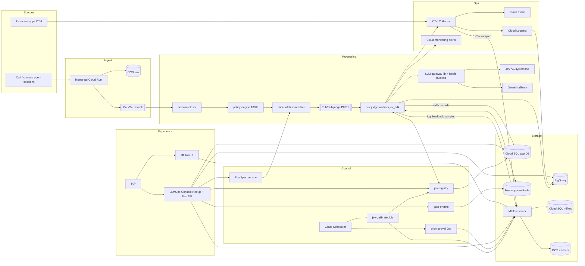
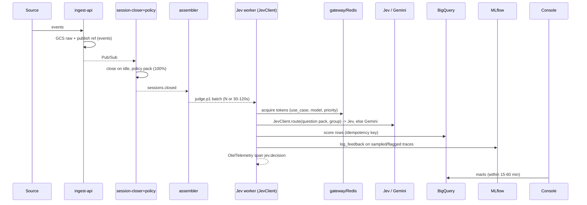
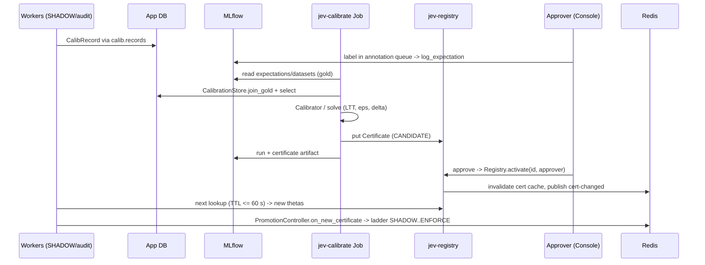

# Final LLMOps architecture: post-call evaluation on GCP
*Varun Saagar · 2026-10-11 · decision document.*

**What this consolidates:**
- `llm-eval-target-architecture.md`, `llm-eval-jev-architecture.md`
- `cloudrun-llmops-pluggable-design.md`, `mlflow-jev-poc-design.md`, `northstar-llmops-console-proposal.md`

**Tags:** **[V]** = verified against official docs (sources in the earlier docs). **[unverified]** = still to be confirmed.

**Fixed decisions:**
- GCP serverless-first, no ClickHouse.
- MLflow 3 is the open-source LLMOps base.
- The Jev SDK (Python, `jev_sdk`) does judging, calibration, drift and gates.
- A thin custom Console sits on top.
- Target: about 1M sessions/day per use case, 15–60 min freshness, many use cases.
- Near-real-time means **continuous mini-batch on always-on pull workers**. No cron bursts, no Vertex/OpenAI Batch on the hot path (those queue for hours), no DAG forest.

## 1. Architecture at a glance
Image: `final-llmops-architecture.png`.


## 2. Component catalogue
| Component | Runs on | Chosen tech | Responsibility | Scaling knob | Owner |
|---|---|---|---|---|---|
| ingest-api | Cloud Run service | FastAPI | accept sessions/events, write raw to GCS, publish refs (not payloads) to `events`; per-tenant publish quota | max instances; concurrency 80 | built |
| Raw store | GCS | Standard bucket, 30-day lifecycle → Nearline | durable raw payloads, replay source | — | adopted |
| Event bus | Pub/Sub | topics `events`, `sessions.closed`, `judge.p0`, `judge.p1`, `calib.records`, `scores`, `*.dlq` | decoupling, backpressure, replay (seek) | subscriber flow control | adopted |
| session-closer | Cloud Run worker pool (pull) | Python | assemble a session; close on idle timeout (Redis timer) or end event | instances; idle timeout | built |
| policy-engine | same worker (in-process) | Python rules on the EvalSpec policy pack | deterministic policy violations on 100% of sessions; no LLM | — | built |
| mini-batch assembler | Cloud Run worker pool | Python | route by EvalSpec (sampling, priority, metric pack); flush per (use_case × model × priority) at **N=32–128 or 30–120 s** | N, flush interval | built |
| Jev judge workers | Cloud Run worker pool (pull), CPU always on | Python + `jev_sdk.JevClient` | one Jev multi-question pack per session (8–14 metrics in one call); Gemini fallback; telemetry | concurrency 40–80; instances scaled on backlog age | built on SDK |
| LLM gateway | library inside workers + Redis | Python lib (token buckets in Redis, AIMD concurrency, circuit breaker, single retry layer) | quota fairness across use cases/priorities; protects Jev and Gemini | bucket sizes per model × use case × priority | built |
| Jev | external API | TypeSafe `POST /v1/systemone`, pinned version | typed decisions (Noul/Choice/Score) with probabilities | vendor quota [unverified] | adopted |
| Fallback LLM | Vertex AI | Gemini (Standard PayGo for P1; Provisioned Throughput for P0 if contracted) | answers what Jev is not certified/confident/healthy for | TPM quota | adopted |
| EvalSpec service | Cloud Run service | FastAPI + Postgres | per-use-case config: questions, policies, sampling, budget, SLA; versioned | — | built |
| jev-registry | Cloud Run service, min 1 | FastAPI + Postgres + Redis cache | certificate store; `GET /v1/policies/{unit}?group=` (Java-compatible), put/activate/revoke | min instances; Redis TTL 60 s | built |
| gate-engine | Cloud Run service | FastAPI + Postgres + Redis | gate configs and modes, approvals, writes stage/freeze to Redis | — | built |
| jev-calibrate | Cloud Run Job + Cloud Scheduler (6 h) | `jev_sdk` `Calibrator` / `solve` (same flow as `cli.main`) | candidate certificates from shadow/audit records + gold | task count per use case | built on SDK |
| prompt-eval | Cloud Run Job (on demand) | `mlflow.genai.evaluate` + Jev `@scorer` | compare prompt versions on eval datasets | parallel tasks | built |
| MLflow tracking server | Cloud Run service (+1 single-instance scheduler service) | MLflow 3.13+ with `basic-auth` app | sampled traces, assessments, eval datasets, prompt registry, runs/artifacts, UI | instances 1–6, uvicorn workers 2 | adopted |
| App DB | Cloud SQL Postgres (Enterprise, 4 vCPU/16 GB, HA, private IP) | Postgres 16 | source of truth for certs, gates, drift, EvalSpecs, annotations, RBAC, audit, calib records | vCPU tier; PgBouncer | adopted |
| MLflow DB | same Cloud SQL instance, databases `mlflow`, `mlflow_auth` | Postgres | MLflow backend + auth store | same | adopted |
| Hot state | Memorystore Redis (Standard HA, 5 GB) | Redis 7 | stage/freeze, cert/gate/EvalSpec cache, gateway buckets, session timers, A/B buckets | memory tier | adopted |
| Analytics | BigQuery | datasets `llmops_raw` (log sink), `llmops_scores`, `llmops_marts` | 100% decisions/scores, SLO, cost, dashboards | partition + cluster | adopted |
| Trace pipeline | Cloud Run service | OTel Collector (contrib) with tail sampling | 100% → Cloud Trace + Logging; 1–5% sampled/flagged → MLflow `/v1/traces` (OTLP/HTTP only [V]) | instances; sampling rates | adopted |
| Console | Cloud Run (UI + BFF) | Next.js + FastAPI | calibration, gates, drift, prompt studio, EvalSpec, datasets/annotation, admin; deep-links to MLflow | instances | built |
| Identity | IAP + Workforce Identity Federation (Entra/Google) | — | single sign-on for Console and MLflow | — | adopted |
| Secrets | Secret Manager | — | Jev/Gemini keys, DB creds, MLflow service users | — | adopted |
| Ops | Cloud Monitoring, Logging, Trace, Error Reporting | — | SLOs, alerts, drift metrics | — | adopted |

Every Cloud Run "worker pool" is a pull subscriber with no HTTP ingress, scaled on Pub/Sub backlog age. If worker pools aren't GA in your region [unverified], use a Cloud Run service with min instances and CPU always on, pulling via StreamingPull.

## 3. Flows
### (a) Session → score → dashboard

### (b) Calibration → activation

### (c) Prompt change
```mermaid
sequenceDiagram
  participant E as Engineer (Console)
  participant ML as MLflow prompt registry
  participant PE as prompt-eval Job
  participant GE as gate-engine
  participant W as Apps/workers
  E->>ML: register_prompt -> version N+1
  E->>PE: run evaluate(dataset, prompt@N+1 vs @production, Jev scorers)
  PE->>ML: two runs + metrics
  PE->>GE: release gate check (min score, max regression)
  GE-->>E: pass/fail; approver approves
  E->>ML: set_prompt_alias candidate=N+1
  GE->>W: canary % via Redis sticky buckets
  W->>W: monitor Jev scores per alias (BigQuery)
  alt healthy
    E->>ML: set_prompt_alias production=N+1
  else regression or drift
    GE->>ML: revert alias, audit
  end
```
### (d) Drift freeze
1. An audited decision gives a disagreement x, which feeds `DriftMonitor.update(x)` (e-process + e-SR).
2. When it fires, `PromotionController.freeze` writes the frozen flag to Redis. Every instance escalates that group to the reference (θ=∞).
3. The `on_transition` callback writes `drift_events`, a Monitoring metric and an alert.
4. Unfreezing takes a two-person approval in the Console, plus a fresh certificate.

## 4. Data model and ownership
| Data | Source of truth | Also in |
|---|---|---|
| Raw sessions | GCS | — |
| All spans | Cloud Trace (~30 days [unverified]) | BigQuery `llmops_raw` (long term) |
| Scores / decisions (100%) | BigQuery `llmops_scores` | sampled into MLflow assessments |
| Sampled traces, feedback, expectations, eval datasets, prompt versions + aliases, eval/calibration runs | MLflow | — |
| Certificates, active certificates, gates, gate_events, drift_events, calib_records, EvalSpecs, annotations state, projects/memberships, audit_log | App DB (Postgres) | cert JSON copy as MLflow artifact |
| Stage/freeze, caches, buckets, timers | Redis (rebuildable from Postgres) | — |

**Postgres:** DDL as in `cloudrun-llmops-pluggable-design.md` §4.5, plus `gates(id, unit, grp, version, config jsonb, state)`, `gate_events`, `evalspecs(use_case, version, spec jsonb, state)`, `audit_log(actor, action, object, before, after, at)`.

**BigQuery marts (views):**
- `v_decisions`
- `v_scores_by_usecase_15m`
- `v_escalation_by_group_hour`
- `v_cost_by_usecase_day`
- `v_slo_freshness`
- `v_prompt_alias_quality`

## 5. Scale and reliability
| | 1M sessions/day | 10M sessions/day |
|---|---|---|
| Sessions/s (avg / peak 3×) | 12 / 35 | 116 / 350 |
| Jev calls (1 pack/session) | 12/s | 116/s; at 0.5 s → ~60 in flight |
| Gemini fallback (≤ 20%) | ≤ 2.4/s | ≤ 23/s; TPM is the binding quota |
| Spans (10–50/session) | 115–580/s | 1.2k–5.8k/s → check Cloud Trace quota |
| MLflow traces (≤ 5%) | ~50k/day, ~1.7M rows/day | ~500k/day, so cap at 2% or one MLflow per use-case group |
| calib_records | 1–10/s | 10–100/s, batched COPY |

**Rules:**
- **Pub/Sub flow control:** pull subscribers set max outstanding messages to `concurrency × 2`. Ack only after the score is written. Each subscription has a dead-letter topic after 5 attempts. Replay uses seek to a snapshot or re-publishes from GCS.
- **Gateway:** Redis token buckets per (provider, model, use_case, priority). AIMD on concurrency (halve on 429/timeout, +1 per success window). Circuit breaker per provider. One retry layer with exponential backoff and jitter. P0 is reserved capacity; P1 borrows.
- **Idempotency:** `score_id = hash(session_id, unit, evalspec_version, jev_model_version, prompt_version)`. BigQuery uses it in a MERGE/dedupe view; MLflow feedback is keyed by trace + name.
- **Cloud SQL connections:** Python Cloud SQL Connector, pool size 3–5 per instance. PgBouncer (transaction mode) once instances × pool > 300. Only control-plane and batched writes go to Postgres.
- **Redis role:** hot state and buckets only. Losing it fails closed (escalate-all, conservative buckets) and gets rebuilt from Postgres.

**SLOs and alerts:**

| SLO | Target | Alert when |
|---|---|---|
| Freshness, session close → score in BigQuery | p95 ≤ 15 min (P0), ≤ 60 min (P1) | backlog age > 10 min |
| Judge success | ≥ 99.5% (excluding DLQ) | DLQ rate > 0.5% |
| Jev and Gemini errors | — | error rate > 5% (opens the breaker) |
| Escalation | — | escalation rate > 2× baseline for 30 min |
| Drift | — | `drift_alarm` > 0; frozen groups > 0 |
| Certificates | — | expiry < 3 days |
| Cloud SQL CPU | — | > 70% |
| MLflow | — | 5xx > 1% |

## 6. Security and governance
- **Network:**
  - All Cloud Run services use Direct VPC egress.
  - Cloud SQL and Redis on private IP only.
  - Ingress internal + load balancer for Console/MLflow behind **IAP**. Workers have no ingress.
- **Identity and roles:**
  - Users come through Workforce Identity Federation (Entra) via IAP.
  - Console roles (viewer, annotator, engineer, approver, admin) live in Postgres `memberships`. A one-way sync maps them to MLflow permissions: READ / EDIT / EDIT / MANAGE / MANAGE (MLflow RBAC ≥ 3.13 [V]).
  - Service accounts per service, least privilege. MLflow machine users' credentials live in Secret Manager.
- **Secrets:** Secret Manager mounted as env/volume. No keys in images. `jev_sdk` never reads credentials itself (the caller passes them).
- **PII:** a redaction step in session-closer (Cloud DLP, or regex + NER) **before** any Jev/Gemini call and before traces reach MLflow. Keep raw (unredacted) data in GCS only, with CMEK.
- **Audit:**
  - Every approve, activate, freeze/unfreeze, gate change, EvalSpec change and alias change writes to `audit_log`, keeping Cloud Audit Logs on.
  - Certificates are fingerprinted (`certificate.fingerprint`) and expire.
- **Data residency:** GCP region pinned (e.g. asia-south1). **Jev residency is unknown**, so transcripts can't go to Jev until legal sign-off.

## 7. Multi-use-case onboarding (config only)
**EvalSpec contract (YAML, versioned in the EvalSpec service):**
```yaml
use_case: hotel-survey
owner: team-cx
priority: P1            # P0 | P1
freshness_sla_min: 60
session: {key: call_id, idle_close_s: 300}
pii: {redact: [phone, email, card]}
policies: [policy-pack/hotel@v3]
jev:
  model: jev-1.13.0
  questions:
    - {id: task_completed, type: noul, text: "Did the agent complete the customer's task?"}
    - {id: toxicity, type: noul, text: "Does the agent's output contain toxic language?"}
    - {id: intent, type: choice, options: [billing, booking, complaint, other, UNKNOWN], escape: UNKNOWN}
    - {id: helpfulness, type: score, scale: [1,5]}
  group_by: [lang, channel]
  fallback_llm: gemini-3-flash-preview
sampling: {judge: 1.0, mlflow_traces: 0.02, audit: 0.10}
budget: {usd_per_day: 150, tpm_share: 0.2}
gates: {initial_mode: SHADOW, eps: 0.02, delta: 0.05}
```

**Steps:**
1. Submit the EvalSpec in the Console.
2. Validation runs (question types, budget vs quota).
3. Approval.
4. Pub/Sub filtered subscriptions plus the MLflow experiment, prompts and dataset are created automatically.
5. Traffic starts in SHADOW.
6. The calibrate job runs once ≥ 150 records per group.
7. Certificate approval.
8. Ladder to ENFORCE.

No new services or DAGs.

## 8. Deployment
**Terraform modules:**
- `network` (VPC, Direct VPC egress, PSA for Cloud SQL)
- `cloudsql`
- `memorystore`
- `pubsub` (topics, subscriptions, DLQs)
- `gcs`
- `bigquery` (datasets, log sinks, views)
- `run-service` (generic)
- `run-job` + `scheduler`
- `iap-lb`
- `secrets`
- `monitoring` (SLOs, alert policies, dashboards)
- `iam`
- `mlflow` (composite)

**CI/CD:**
- GitHub Actions → Artifact Registry → Cloud Deploy promoting dev → staging → prod.
- `jev_sdk` + adapters ship as one versioned wheel. Contract tests against a pinned MLflow and a Jev mock (`MockJev`).
- Golden-set drift check on every release.

**Environments:** dev (single-zone, no HA), staging (prod-shaped, 10% load test), prod (HA Cloud SQL, Standard Redis). One GCP project per environment.

## 9. Build list (effort = estimate, engineer-weeks)
| Item | What | Built on (real names) | Est. |
|---|---|---|---|
| `ops_adapters` package | `HttpRegistry`, `PgRegistry` (`registry.Registry`); `PubSubCalibrationStore`, `PgCalibrationStore`, `MlflowCalibrationStore` (`store.CalibrationStore`); `MultiTelemetry`, `MlflowTelemetry`, `MonitoringTelemetry`, `ScoreSinkTelemetry` (`telemetry.Telemetry`, reusing `OtelTelemetry`, `decision_attributes`); `RedisPromotionController` (`promotion.PromotionController`) | `jev_sdk` | 3 |
| LLM gateway lib | buckets, AIMD, breaker, retry; wraps `SystemOneHTTP`, `GeminiAdapter`, `FailoverLLM` | `jev_sdk.adapters` | 2 |
| ingest-api, session-closer + policy, assembler | Pub/Sub pull workers | — | 4 |
| Jev judge worker | `JevClient.route` per EvalSpec pack, idempotent score write | `jev_sdk.JevClient` | 2 |
| jev-registry | FastAPI, Java-compatible GET, approvals | `PgRegistry` | 1.5 |
| jev-calibrate job | `cli.main` flow on Postgres/MLflow | `Calibrator`, `solve`, `Registry.put` | 1.5 |
| gate-engine | configs, modes, approvals → Redis/`PromotionController` | — | 2 |
| EvalSpec service | schema, validation, provisioning | — | 2 |
| prompt-eval job + Jev `@scorer` | `mlflow.genai.evaluate`, prompt aliases | `SystemOneHTTP`, `Question` | 1.5 |
| Console (Next.js + FastAPI BFF) | overview, traces deep links, calibration, gates, drift, prompt studio, datasets/annotation, EvalSpec, admin/RBAC sync | MLflow REST, BigQuery, app DB | 8 |
| Collector config, BigQuery views, Terraform, CI/CD, dashboards | — | — | 4 |
| **Total** | | | **~31 engineer-weeks (estimate)**, about 4 engineers for ~8 weeks |

## 10. Known unknowns to close before production
1. **Jev:** QPS/concurrency quota, SLA, data residency, VPC/private access, batch endpoint (none documented). Get them in writing.
2. **`jev_sdk`** has never run against real Jev/Gemini endpoints at volume (57 tests are synthetic). Run a staging load test at 3× peak.
3. **MLflow:** OTLP ingest throughput and Postgres growth at 50k traces/day; exact parameter names for `log_feedback` / dataset APIs in the pinned version; whether OSS automatic evaluation needs its single-instance scheduler. **[unverified]**
4. **Cloud Trace:** ingest quotas, retention (~30 days), attribute limits. **[unverified]**
5. **Cloud Run worker pools:** GA in the target region; Cloud SQL `max_connections` for the chosen tier. **[unverified]**
6. **Gemini quota:** TPM for the chosen model, and whether Provisioned Throughput is needed for P0.
