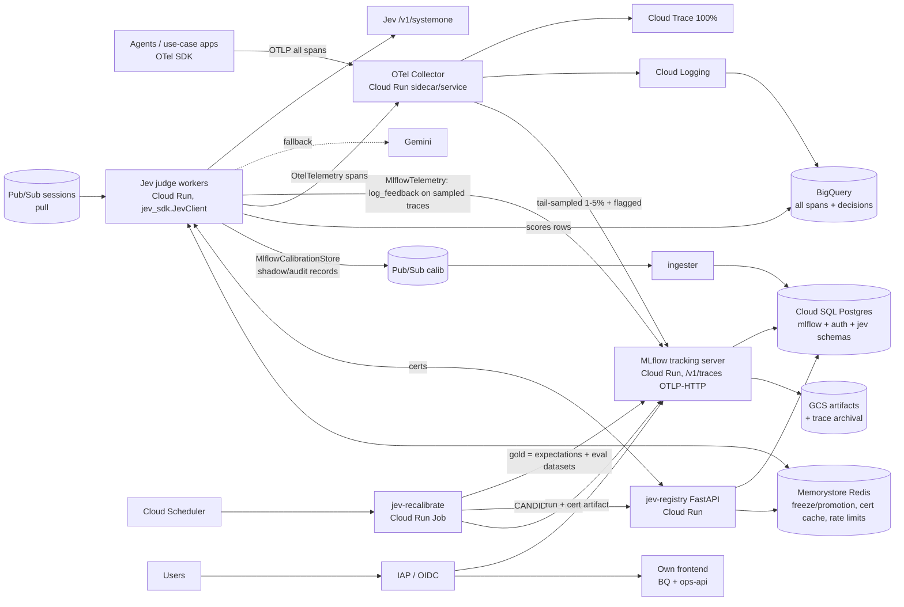

# MLflow 3 + Jev SDK (Python) POC on GCP
*Varun Saagar · 2026-10-11 · design draft.*

**How facts are marked:**
- **[V]** = verified by fetching mlflow.org/docs/latest on 2026-10-11 (URLs in §8).
- **[U]** = unverified (background knowledge). Re-check these before you rely on them.
- This doc builds on `/workspace/cloudrun-llmops-pluggable-design.md`. That doc's Postgres DDL, OTel attribute list, Redis promotion state and rollout still apply unless replaced here.

## 1. What MLflow gives us vs what we build
| MLflow 3 OSS gives us | Status |
|---|---|
| Trace store + UI (span payloads in the SQL tracking DB; archival of old payloads to the artifact store via `--trace-archival-config`, with retention and `long_retention_allowlist`) | [V] |
| OTLP/HTTP ingest at `/v1/traces` (header `x-mlflow-experiment-id`; **gRPC not supported**) | [V] |
| `mlflow.trace` / autolog / async logging (`MLFLOW_ENABLE_ASYNC_TRACE_LOGGING`, `..._MAX_WORKERS`, `..._MAX_QUEUE_SIZE`) and trace-level sampling (rate 0..1) | [V] |
| `MlflowClient.delete_traces` (not for Databricks UC traces) | [V] |
| Assessments: `mlflow.log_feedback`, `mlflow.log_expectation`; feedback editable in the UI | [V] |
| Evaluation datasets (`create_dataset`), **SQL backend required** (Postgres OK) | [V] |
| Custom scorers `@scorer` + `mlflow.genai.evaluate` | [V] (scorers page fetched; exact signature [U]) |
| Automatic evaluation: `judge.register(name=...)` + `.start(sampling_config=ScorerSamplingConfig(sample_rate, filter_string))` in OSS docs | [V] docs; behaviour of the OSS server scheduler at our volume [U] |
| Prompt registry | [V] |
| Auth app: permissions READ / USE / EDIT / MANAGE / NO_PERMISSIONS; RBAC roles API and admin UI from **3.13.0**; workspaces; `MLFLOW_AUTH_ADMIN_USERNAME/PASSWORD`; auth DB can be Postgres | [V] |
| Server security middleware (`--allowed-hosts`, `--cors-allowed-origins`), uvicorn (`--uvicorn-opts`) | [V] |

**What we build (thin):**
- Sampler/forwarder.
- Jev judge worker.
- Six adapters into `jev_sdk` (§3).
- Registry service, kept from the earlier design.
- Calibration Cloud Run Job.
- BigQuery views and the frontend.
- An IAP or OIDC front door.

**Avoid (Databricks-managed only, or not in OSS) [U unless noted]:**
- Review App and labeling sessions (`mlflow.genai.labeling`)
- Unity Catalog trace tables and UC eval datasets ([V] that UC traces don't support `delete_traces`)
- Databricks-hosted built-in judges/agents endpoints
- Databricks Lakehouse Monitoring
- Mosaic Agent Evaluation UI

Wherever the docs say "Databricks", assume it needs a workspace.

## 2. Architecture

The certificate source of truth is the **Postgres registry** behind `jev-registry` (it needs fast reads and atomic activation). Each recalibration is *also* logged as an MLflow run with the certificate JSON as an artifact, for lineage and the UI. MLflow model aliases are optional (see the `MlflowRegistry` variant).

## 3. Jev SDK plug points → MLflow (real `jev_sdk` names; adapters are new code)
| `jev_sdk` hook | Adapter | MLflow / GCP API |
|---|---|---|
| `telemetry.Telemetry.emit(d)` (existing `OtelTelemetry`, span `jev.decision`) | keep `OtelTelemetry` → Collector. New **`MlflowTelemetry`**: for sampled or flagged decisions, `mlflow.log_feedback(trace_id=..., name=d.unit, value=..., source=AssessmentSource(LLM_JUDGE, d.answered_by), metadata=decision_attributes(d))`. Wrap both in **`MultiTelemetry`** | `log_feedback` [V] |
| `store.CalibrationStore` (`add/join_gold/select/groups`, `CalibRecord`) | **`MlflowCalibrationStore`**: `add()` → Pub/Sub → Postgres `calib_records` (high volume stays out of MLflow). `join_gold()` reads human labels from MLflow **expectations** (`mlflow.log_expectation`) and eval datasets, keyed by `request_id` stored as a trace tag | `log_expectation`, `search_traces`, `create_dataset` [V] (exact read API for dataset records [U]) |
| `registry.Registry` (`put/get/active/activate/revoke`) | **`HttpRegistry`** (workers) and **`PgRegistry`** (service/job), as in the earlier design. Optional **`MlflowRegistry`**: `put` = log the certificate JSON as an artifact on a run; `activate` = set a model alias `champion` on a registered model `jev-cert-{unit}-{group}` (UI approval), synced to Postgres | model registry aliases [U for POC] |
| `promotion.PromotionController(on_transition=...)` | the callback writes `drift_events` + Monitoring metric + an MLflow trace tag/feedback `jev.freeze` on the triggering trace. **`RedisPromotionController`** shares state | — |
| `JevClient.calibrate / activate`, `cli.main` (`jev-calibrate --config --store --registry [--activate]`) | **Cloud Run Job** running the same flow with `MlflowCalibrationStore` + `PgRegistry`. `mlflow.start_run()` logs eps/delta/method, n_valid and the certificate artifact. Never `--activate` in the job | runs/artifacts [V-standard] |
| Gold-label UI | MLflow trace UI feedback/expectation editing ([V]) + our own annotation queue. Review App is Databricks-only [U] | — |

```python
# ops_adapters/mlflow_telemetry.py  (new)
import mlflow
from mlflow.entities import AssessmentSource, AssessmentSourceType
from jev_sdk.telemetry import Telemetry, decision_attributes

class MlflowTelemetry(Telemetry):
    def __init__(self, trace_id_of, sample=lambda d: d.reason.value != "ACCEPTED" or d.audited):
        self.trace_id_of, self.sample = trace_id_of, sample      # trace_id_of: Decision -> MLflow trace id or None
    def emit(self, d):
        tid = self.trace_id_of(d)
        if not tid or not self.sample(d):
            return
        mlflow.log_feedback(trace_id=tid, name=f"jev.{d.unit}", value=d.answer,
                            source=AssessmentSource(source_type=AssessmentSourceType.LLM_JUDGE, source_id=d.answered_by),
                            metadata={k: str(v) for k, v in decision_attributes(d).items()})

class MultiTelemetry(Telemetry):
    def __init__(self, *sinks): self.sinks = sinks
    def emit(self, d):
        for s in self.sinks:
            try: s.emit(d)
            except Exception: pass          # telemetry never breaks routing

# ops_adapters/mlflow_store.py  (new)
from jev_sdk.store import CalibrationStore
class MlflowCalibrationStore(CalibrationStore):
    def __init__(self, publisher, pg):            # no JSONL path
        super().__init__(None); self.pub, self.pg = publisher, pg
    def add(self, r):        self.pub.publish(r)                     # -> calib_records
    def select(self, unit, group, since=0.0, gold_only=False): return self.pg.select(unit, group, since, gold_only)
    def groups(self):        return self.pg.groups()
    def join_gold(self, gold=None):
        gold = gold or gold_from_mlflow()   # request_id -> label, from mlflow.search_traces(...) expectations
        return self.pg.set_gold(gold)
```
Worker wiring is the same as §4.2 of the earlier doc, with `telemetry=MultiTelemetry(OtelTelemetry(), MlflowTelemetry(...), ScoreSinkTelemetry(...))` and `store=MlflowCalibrationStore(...)`.

## 4. Sampling and volume (1M sessions/day per use case)
- **Cloud Trace / BigQuery:** 100% of spans, about 10–50M spans/day.
- **MLflow:** **all** flagged sessions (escalated, frozen, policy violation, audit-sampled, user-reported), plus a **1–2% random sample**. Flagged sessions are about 10% audit plus about 5–15% escalation, but the audited and escalated sessions don't all need full traces. Cap flagged sessions at 3%. Target ≤ 5% total, about **50k traces/day**.
- **Rows in MLflow Postgres (estimate):**
  - 50k traces × ~20 spans = **~1M span rows/day**
  - plus trace info/tags about 0.5M rows/day
  - plus assessments 50k × 3–5 = **~0.2M rows/day**
  - about 1.7M rows/day, ~20 rows/s average, peaks of maybe 200/s. That's comfortable for one Cloud SQL instance.
  - Span payloads are maybe 2–10 KB each, so about 5–10 GB/day before archival. Use **trace archival to GCS after 7 days** and delete after 30–90 days.
- **Jev tables** (`calib_records`, about 5–100/s in shadow mode) are in the same instance but a separate database.
- **Revisit** if MLflow trace ingest needs >10% sampling or >500k traces/day per instance.

## 5. Cloud Run + Cloud SQL + Memorystore sizing
- **MLflow server on Cloud Run:**
  - Image `ghcr.io/mlflow/mlflow:v3.x` + `psycopg2` + `google-cloud-storage` (+ `mlflow[auth]`).
  - Command: `mlflow server --host 0.0.0.0 --port 8080 --backend-store-uri postgresql+psycopg2://…@/mlflow?host=/cloudsql/PROJ:REGION:INST --artifacts-destination gs://BUCKET/mlflow --serve-artifacts --allowed-hosts <run.app host> --app-name basic-auth --uvicorn-opts "--workers 2"` (flags [V]; the `--uvicorn-opts` workers syntax [U]).
  - 2 vCPU / 4 GB, concurrency 40, min instances 1, max 4–6, Cloud SQL volume mount (Unix socket).
  - **Archival and periodic tasks on exactly one instance** ([V]: the docs say multi-replica deployments must enable scheduling on one instance). Run a separate 1-instance "mlflow-scheduler" service, or set max=1 for the POC.
- **Auth:** `basic-auth` app with its DB on Postgres (database `mlflow_auth`). For SSO, put **IAP** in front (Google/Entra via Workforce Identity) and map IAP users to MLflow users, or use the community **`mlflow-oidc-auth`** plugin [U: maturity and 3.13 RBAC compatibility]. Machine clients (workers, Collector) use service-account → basic-auth credentials from Secret Manager.
- **Connections:** max instances × uvicorn workers × SQLAlchemy pool (`MLFLOW_SQLALCHEMY_POOL_SIZE` ~5 [U]) is about 6×2×(5+overflow 5) = 120. Workers + ingester + registry add about 60. Cloud SQL 4 vCPU/16 GB (`max_connections` default about 400 [U]) is enough. Add PgBouncer past ~300 connections.
- **Cloud SQL Postgres:** Enterprise, 4 vCPU/16 GB, 250 GB SSD, autoresize, HA for prod (POC: no HA). Not scale-to-zero. Enterprise Plus or AlloyDB only if write latency hurts.
- **Memorystore Redis:** Basic 1 GB (POC), Standard HA 5 GB (prod). Holds freeze/promotion hashes, cert cache and token buckets.
- **Collector:** Cloud Run service, 1 vCPU, `tail_sampling` processor with policies (status=error, attribute `calib.escalation_reason!=ACCEPTED`, `calib.audit_sampled=true`, probabilistic 2%). Two exporters: `googlecloud` (all) and `otlphttp` → MLflow `/v1/traces` with header `x-mlflow-experiment-id`.

## 6. POC plan (3 weeks) and path to production
| Week | Deliverable | Success criteria |
|---|---|---|
| 1 | Cloud SQL, GCS, MLflow on Cloud Run behind IAP + basic-auth; Collector dual export; one use case instrumented | 100% of spans in Cloud Trace/BQ; sampled traces visible in the MLflow UI within 1 min; 3 roles (viewer/annotator/admin) enforced |
| 2 | Jev judge worker (Pub/Sub pull) with `MultiTelemetry` + `MlflowCalibrationStore` + `HttpRegistry` + Redis promotion; SHADOW mode | ≥ 200 sessions/s sustained in a load test; MLflow Postgres p95 write < 100 ms; zero lost assessments; `log_feedback` visible on traces |
| 3 | `jev-recalibrate` Job (gold from expectations/datasets) → CANDIDATE cert → approve → canary 5%; drift alerts; trace archival | Certificate produced from ≥ 150 labelled rows per group; freeze propagates to all instances in < 5 s; archival job runs; cost/day projected |

**Production path:**
- HA Cloud SQL and PgBouncer.
- A per-use-case MLflow experiment, using workspaces if needed ([V] that workspaces exist).
- Terraform.
- Retention policy.
- Then onboard more use cases.

**Revisit Langfuse v3 + ClickHouse (or ClickHouse Cloud) when any of these happen:**
- MLflow needs > ~10% of traces or > 500k traces/day.
- Postgres span tables pass ~1 TB.
- The trace UI or search gets slow.
- Per-project RBAC/SCIM needs exceed MLflow's RBAC.

## 7. Risks and unverified items
- **[U]** Exact `mlflow.log_feedback` / `AssessmentSource` parameter names, the eval-dataset read API, and `@scorer` signature details. Pin an MLflow version (≥ 3.13 for RBAC) and test.
- **[U]** Whether OSS automatic evaluation (`register().start()`) needs a long-running server-side scheduler that conflicts with multi-replica Cloud Run. Prefer our own Jev workers for production scoring.
- **[U]** Review App / labeling sessions are Databricks-only. Plan our own annotation queue.
- **[U]** `mlflow-oidc-auth` maturity. IAP + basic-auth is the safe default.
- **[U]** MLflow OTLP ingest throughput and Postgres span-table growth at 50k traces/day. Load-test in week 2.
- **[U]** Cloud Trace quotas and retention (~30 days) and Cloud SQL `max_connections` per tier, carried over from the earlier doc.
- **Risk:** OTLP into MLflow is HTTP-only (no gRPC) [V]. The Collector must use the `otlphttp` exporter.
- **Risk:** the `jev_sdk` adapters are new code, and the SDK has not been run against real Jev/Gemini endpoints at volume. Jev quota/SLA/residency is unknown, so redact PII before Jev calls and before traces reach MLflow.

## 8. Sources (fetched 2026-10-11)
- Tracing overview: https://mlflow.org/docs/latest/genai/tracing/
- OpenTelemetry integration: https://mlflow.org/docs/latest/genai/tracing/opentelemetry/
- OTLP ingest (`/v1/traces`, HTTP only, `x-mlflow-experiment-id`): https://mlflow.org/docs/latest/genai/tracing/opentelemetry/ingest/
- Production tracing (async logging, sampling, automatic evaluation `register/start`): https://mlflow.org/docs/latest/genai/tracing/prod-tracing/
- Delete traces: https://mlflow.org/docs/latest/genai/tracing/observe-with-traces/delete-traces/
- Feedback: https://mlflow.org/docs/latest/genai/assessments/feedback/ ; expectations: https://mlflow.org/docs/latest/genai/assessments/expectations/
- Evaluation datasets (SQL backend required): https://mlflow.org/docs/latest/genai/datasets/
- Scorers: https://mlflow.org/docs/latest/genai/eval-monitor/scorers/ ; eval & monitor: https://mlflow.org/docs/latest/genai/eval-monitor/
- Prompt registry: https://mlflow.org/docs/latest/genai/prompt-registry/
- Auth / RBAC (READ/USE/EDIT/MANAGE/NO_PERMISSIONS, RBAC ≥ 3.13): https://mlflow.org/docs/latest/self-hosting/security/basic-http-auth/
- Tracking server (backend store, artifacts, trace archival, single-instance scheduler, uvicorn opts, allowed-hosts): https://mlflow.org/docs/latest/self-hosting/architecture/tracking-server/
- `mlflow-oidc-auth` (community, [U]): https://github.com/mlflow-oidc/mlflow-oidc-auth
- Cloud SQL from Cloud Run: https://cloud.google.com/sql/docs/postgres/connect-run [U this session]
- Local: `fine-tuning/jev-sdk/src/jev_sdk/{telemetry,store,registry,promotion,router,cli}.py`
